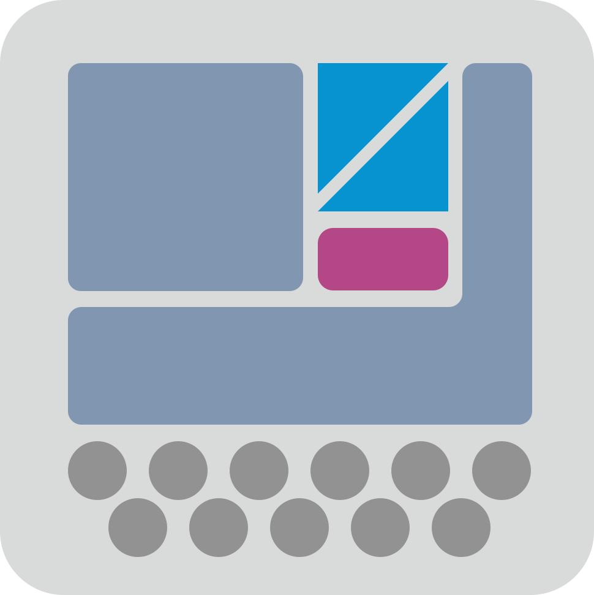

# Serula Nesting Pro

  

  ### Üretim odaklı DXF nesting ve kesim hazırlığı

  Ayakkabı, suni deri, tekstil, lazer ve CNC üretimi için gerçek geometriyle rulo/plaka yerleştirme.

  **[🌐 Serula Web](https://serula.site/)** · **[🖥️ Serula Pro PC](https://github.com/M93hasan/serula-nesting-pro-pc/releases/latest)** · **[⬇️ Windows Aktarım Köprüsü](integrations/windows/Serula-Kur.cmd)** · **[Sorun bildir](https://github.com/M93hasan/nesting/issues)**

     

> **İki GitHub deposu ayrı kalıyor.** Buradaki **M93hasan/nesting** web uygulamasının, Cloudflare Worker'ın, WASM motorunun ve Windows aktarım köprüsü kurucusunun deposudur. Windows masaüstü uygulaması **[M93hasan/serula-nesting-pro-pc](https://github.com/M93hasan/serula-nesting-pro-pc)** içinde tutulur. Bu README, iki depoyu birleştirmez.

---

## İçindekiler

1. [Proje ve sürümler](#1-proje-ve-sürümler)
2. [Hızlı kullanım](#2-hızlı-kullanım)
3. [Özelliklerin kapsamı](#3-özelliklerin-kapsamı)
4. [Dosya içe aktarma](#4-dosya-içe-aktarma)
5. [Nesting ve malzeme kuralları](#5-nesting-ve-malzeme-kuralları)
6. [DXF dışa aktarım ve geometri](#6-dxf-dışa-aktarım-ve-geometri)
7. [CorelDRAW / RDWorks köprüsü](#7-coreldraw--rdworks-köprüsü)
8. [Bulut, geçmiş ve hesaplar](#8-bulut-geçmiş-ve-hesaplar)
9. [Yönetici paneli](#9-yönetici-paneli)
10. [Klavye ve arayüz](#10-klavye-ve-arayüz)
11. [Mimari ve klasör yapısı](#11-mimari-ve-klasör-yapısı)
12. [Kurulum ve geliştirme](#12-kurulum-ve-geliştirme)
13. [WASM derleme ve doğrulama](#13-wasm-derleme-ve-doğrulama)
14. [Cloudflare dağıtımı](#14-cloudflare-dağıtımı)
15. [Testler](#15-testler)
16. [Güvenlik ve veriler](#16-güvenlik-ve-veriler)
17. [Sık karşılaşılan sorunlar](#17-sık-karşılaşılan-sorunlar)
18. [Sınırlar ve üretim kontrolü](#18-sınırlar-ve-üretim-kontrolü)
19. [Katkı, lisans ve iletişim](#19-katkı-lisans-ve-iletişim)

## 1. Proje ve sürümler

**Serula Nesting Pro**, üretim parçalarını gerçek ölçüleriyle rulo veya sabit ölçülü plaka malzemeye yerleştiren, sonucu görüntüleyen ve DXF olarak dışa aktarabilen web tabanlı bir 2B nesting sistemidir. Hedef alanları arasında ayakkabı, deri/suni deri, tekstil, lazer kesim ve CNC hazırlığı bulunur.

| Bileşen | Kaynak | 14.10.2026 itibarıyla |
|---|---|---|
| Web uygulaması | [web/package.json](web/package.json) | **0.1.11** |
| Canlı adres | [serula.site](https://serula.site) | Cloudflare Git entegrasyonu |
| Windows PC sürümü | [ayrı PC deposu](https://github.com/M93hasan/serula-nesting-pro-pc) | **0.1.11** |
| Windows aktarım köprüsü | [SerulaTransferBridge.ps1](integrations/windows/SerulaTransferBridge.ps1) | **1.4** |
| Nesting motoru | [Sparrow](https://github.com/JeroenGar/sparrow) + Jagua | Rust / WebAssembly |
| Veri ve API | [Cloudflare Worker](web/worker/serula-worker.js) | Cloudflare D1 |

Sürüm bilgisini her zaman ilgili **package.json**, **GitHub Release** ve çalışan köprünün **/health** yanıtı üzerinden doğrulayın. Bu tablo gelecekteki sürümleri otomatik takip etmez.

### Temel ilkeler

- **Gerçek geometri korunur.** İzin verilmedikçe parça ölçüsü değiştirilmez.
- **Yerleşim kısıtları uygulanır.** Malzeme sınırı, parça aralığı ve dönüş izinleri önemlidir.
- **Rulo ve plaka farklı üretim senaryolarıdır.** Rulo stabilitesini plaka düzenlemeleri bozmamalıdır.
- **Geçerli sonuç kontrol edilir.** Hatalı veya boş yerleşim başarılı sonuç gibi sunulmamalıdır.
- **DXF mümkün olduğunda özgün çizim varlıklarıyla çıkar.** Kaynak SPLINE/ARC/CIRCLE çizimlerini gereksiz yere noktalandırmamak önceliktir.
- **Kesim yetkisi Serula'da değildir.** DXF aktarımı makineye otomatik kesim komutu göndermez.

## 2. Hızlı kullanım

1. **[https://serula.site](https://serula.site)** adresinden editörü açın.
2. DXF, SVG veya PLT/HP-GL parçalarını içe aktarın.
3. Parça sayısı, açık kontur, katman, ölçek ve ölçüleri gözden geçirin.
4. Her parça için **İzin verilen dönüşler** değerini belirleyin.
5. **Rulo** veya **Plaka** seçip malzeme ölçülerini ve **parça aralığı** değerini girin.
6. İhtiyaç varsa başlangıç köşesini ve durdurma koşulunu seçin.
7. **Yerleştir** işlemini çalıştırın; geçerli yerleşimi kontrol edin.
8. **DXF İndir** ile kaydedin ya da yetkiniz ve Windows köprüsü varsa **CorelDRAW'a Aktar** / **RDWorks'e Aktar** seçin.
9. Hesabınıza bağlı proje/çıktıları **Geçmiş** bölümünden tekrar açın.

**Örnek çalışma:** 1400 mm genişliğinde rulo, 0 mm parça boşluğu, 0°/180° dönüş. Bu yalnızca bir başlangıç senaryosudur; malzemenin ve makinenin gerektirdiği toleranslar operatör tarafından girilmelidir.

## 3. Özelliklerin kapsamı

| Alan | İşlev |
|---|---|
| Düzenleme | Parça seçme, taşıma, adet değiştirme, çoğaltma, silme |
| Çoklu seçim | Fare alan seçimi; Ctrl/Shift destekli toplu seçim |
| Dönüş | İzin verilen açı kuralları; seçili parçaya derece girerek döndürme |
| Aynalama | Seçilmiş kopyayı yatay veya dikey aynalama |
| Malzeme | Rulo, sabit ölçülü plaka ve çoklu plaka |
| Yerleştirme | Rust/WASM Sparrow/Jagua, Web Worker üzerinde hesap |
| İçe aktarma | DXF, SVG, PLT/HP-GL, desteklenen proje JSON/ZIP |
| Dışa aktarma | Geçerli DXF, kaynak geometriyi korumaya yönelik dönüşümler |
| Kurtarma | Tarayıcı içi proje kaydı ve geri yükleme |
| Bulut | Giriş yapılmış hesaba bağlı otomatik proje kaydı |
| Geçmiş | DXF export kayıtları; proje geri yükleme |
| Hesap | E-posta/parola, Google giriş ve yönetici yetkileri |
| Destek | Kalıcı mesajlaşma, onaylı uzaktan destek akışı |
| Dil | Türkçe, English, العربية, فارسی (İran) ve RTL destek |
| Tema/birim | Açık, koyu, sistem teması; mm/inç görüntüleme |
| Windows | CorelDRAW ve RDWorks'e izinli yerel DXF aktarımı |

Bazı özellikler hesap veya yönetici yetkisi gerektirir. Bir özelliğin arayüzde görünmesi, her Windows/RDWorks sürümünde sorunsuz çalışacağını garanti etmez.

## 4. Dosya içe aktarma

### DXF

Başlıca desteklenen 2B entity tipleri:

- **LINE**
- **ARC**
- **CIRCLE**
- **ELLIPSE**
- **LWPOLYLINE / POLYLINE** (uygun bulge bilgileri dâhil)
- **SPLINE** (desteklenen eğri biçimleri)
- **INSERT / BLOCK** (desteklenen 2B dönüşümlerle)

Katman bilgileri, iç boşluklar, kaynak renkleri ve desteklenen yardımcı işaret/detay çizimleri değerlendirilir. Bağlı orijinal DXF varlıkları parça veri modelinde saklanabilir. Geometrisi bozuk veya açık kontur, güvenli inceleme adımı ya da uyarı gerektirebilir.

**Birim:** Geometri milimetre temellidir. Tanınan DXF birimleri içe aktarımda kullanılır. Dışa aktarılan DXF başlığındaki **INSUNITS 4**, 1 birimin 1 mm olduğunu belirtir. Özellikle farklı CAD programlarından gelen dosyalarda gerçek ölçüyü kontrol edin.

**SPLINE:** Desteklenen kontrol noktası/knot bilgisiyle geldiğinde kaynak eğriyi koruma hedeflenir. Her tür spline, 3B DXF veya üreticiye özgü veri biçimi desteklenmez.

### SVG

Kapalı üretim konturları, desteklenen yol/transform işlemleri ve iç delikler işlenir. Yazı, görsel, filtre/maske ve harici kaynaklar doğrudan lazer kesim konturu kabul edilmez. İçe aktarma sonrası konturları inceleyin.

### PLT / HP-GL

Desteklenen uzantılar **.plt, .hpgl, .hpg, .hgl**. PU, PD, PA, PR gibi çizici komutları ve desteklenen yay/daireler çözülür. Standart HP-GL ölçeği **40 plotter birimi = 1 mm** olabilir. SC/IP gibi ölçeklemelerde ve cihazlara özgü çıktılarda gerçek ölçüyü doğrulayın.

### Proje / ZIP

Desteklenen proje JSON ve ZIP arşivleri yeniden açılabilir. **Projeyi açma**, tüm proje durumunu yükleyebilir; **parça içe aktarma**, mevcut projeye yeni konturlar ekler. İkisini karıştırmayın.

## 5. Nesting ve malzeme kuralları

### Motor

Hesaplama çekirdeği **Rust + WebAssembly**'dir. [Sparrow](https://github.com/JeroenGar/sparrow) tabanlı yerleştirme ve Jagua geometrisi kullanılır; hesap ağır yükü Web Worker'larda yürütülür.

Kaynak kodun pinlediği Sparrow commit'i:

~~~text
5901a79b6c5a74d8b9c356ee2916736567308108
~~~

Kesin güncel bağımlılıklar [web/wasm/Cargo.toml](web/wasm/Cargo.toml) ve [web/wasm/Cargo.lock](web/wasm/Cargo.lock) dosyalarındadır. **Eski README'de belirtilen önceki Sparrow/Jagua sürümleri bu kodun kaynağı değildir.**

### Varsayılan ayarlar

| Ayar | Başlangıç değeri |
|---|---|
| Malzeme tipi | Rulo |
| Malzeme genişliği | **1400 mm** |
| Parça aralığı | **0 mm** |
| Başlangıç köşesi | **Sağ alt** |
| Yeni parçanın dönüşleri | **0° ve 180°** |
| Varsayılan çözüm süresi | **30 saniye** |

İzin verilen dönüşler parça bazında sabit, yarım dönüş veya serbest kural olarak ayarlanabilir. Elle dönüş/aynalama sonrasında DXF doğrulaması yine geçerlidir.

**Süre uyarısı:** Arayüzde otomatik durdurma ve süre seçenekleri bulunur. Ağır geometrilerde tamamlanma süresi değişebilir; **her dosya 59 saniyede mutlaka biter** garantisi yoktur.

### Rulo modu

Kullanıcı **genişliği** belirler; çözüm bu sınır içinde kullanılan uzunluğu mümkün olduğunca azaltmayı hedefler. Ruloda plaka sayısı veya plaka X-ofset kuralı uygulanmaz.

### Plaka modu

Kullanıcı hem **genişlik hem uzunluk** belirler. Birinci fiziksel plakaya sığmayan kopyalar sonraki plakalara alınabilir. Amaç plaka için ikinci bir gizli shelf/grid algoritmasına geçmek değil, Sparrow tabanlı çözümü fiziksel plaka kısıtlarıyla yönetmektir.

### Çoklu plaka dışa aktarma

Birden fazla plaka çıktısı **tek DXF** olur. Plakalar yatay dizilir ve aralarında **50 mm** boşluk bırakılır; parçaların kendi iç yerleşimi ve yönleri değiştirilmez.

~~~text
Plaka genişliği: 1400 mm

Plaka 1 başlangıcı: X =    0 mm
Plaka 2 başlangıcı: X = 1450 mm
Plaka 3 başlangıcı: X = 2900 mm

X ofseti = plaka index × (malzeme genişliği + 50 mm)
~~~

Sabit kaynak: [web/src/export/dxf.ts](web/src/export/dxf.ts), **SHEET_EXPORT_GAP_MM = 50**. Kesim DXF'ine yalnızca plaka göstermek için dekoratif kapalı bir çerçeve/dikdörtgen eklenmez.

### Doğrulama kuralları

- Parçalar gerçek boyutlarını ve iç boşluklarını korumalıdır.
- Çakışma ve sınır ihlalleri kontrol edilmelidir.
- Parça aralığı **kerf (ışın kalınlığı)** yerine geçmez.
- İzin verilen dönüşler kaybolmamalıdır.
- Hatalı/boş çözüm başarılıymış gibi dışa aktarılmamalıdır.
- Rulo optimizasyonuna yapılan değişiklikler plaka üzerinden dolaylı bozulmaya neden olmamalıdır.

## 6. DXF dışa aktarım ve geometri

Serula, hesaplama için poligon/sampling kullanabilse de kaynak CAD entity bilgilerini ayrı saklayarak **gereksiz noktalandırmayı önlemeyi** hedefler.

Uygun kaynak ve dönüşümlerde:

| Kaynak | Tercih edilen export |
|---|---|
| LINE | LINE |
| ARC | ARC |
| CIRCLE | CIRCLE |
| SPLINE | SPLINE |
| LWPOLYLINE | LWPOLYLINE |
| POLYLINE | POLYLINE |

Konum, dönüş, ayna ve çoklu plaka X-ofseti bu nesnelere uygulanır. İç delik, katman ve bağlı detay geometrileri korunmaya çalışılır. Bazı uyumsuz kaynak dosyalarda poligon tabanlı dışa aktarma gerekebilir: **tüm DXF çeşitlerinde kayıpsız export sözü verilmez**.

Kaynak eğrilerin varlık tipinin veya SPLINE kontrol noktası sayısının beklenmedik değişmesi gibi durumlar için kontrol kodları bulunur. Dışa aktarımdan sonra **CorelDRAW veya RDWorks içinde parça adedini, ölçüleri, katmanları ve kontur sürekliliğini mutlaka kontrol edin.**

## 7. CorelDRAW / RDWorks köprüsü

### İndirme seçenekleri

| Kullanım | İndirme | Ek kurulum |
|---|---|---|
| **PC uygulaması** | [Serula Nesting Pro PC · son Release](https://github.com/M93hasan/serula-nesting-pro-pc/releases/latest) | Masaüstü kurulum; köprü paket içinde |
| **Sadece web / Chrome** | [Serula-Kur.cmd](integrations/windows/Serula-Kur.cmd) | Windows'a yerel köprüyü kurar |
| **Geliştirici / manuel** | [SerulaTransferBridge.ps1](integrations/windows/SerulaTransferBridge.ps1) | PowerShell ve localhost yetkileri |

**Köprü v1.4**, Windows PowerShell 5.1 üzerinde çalışacak şekilde hazırlanmıştır. Tek tıklamalı kurucu güncel sürümü indirip doğrular, kullanıcının yerel makinesine kurar ve Windows oturum açılışında çalıştıracak kısayol oluşturur. İlk kurulumda sadece yerel HTTP URL rezervasyonu için yönetici onayı gerekebilir.

Kurulumu kontrol etmek için **aynı Windows bilgisayarında**:

~~~text
http://127.0.0.1:43842/health
~~~

Beklenen örnek:

~~~json
{"ok":true,"service":"serula-bridge","version":"1.4"}
~~~

Kurucunun güvenlik özelliği: içeriği GitHub'da belirli commit/blob kimliğine sabitler ve indirilen dosyanın Git blob SHA-1 değerini kontrol eder. Daha önce indirdiğiniz **eski Serula-Kur.cmd**, sabitlendiği eski sürümü yükleyebileceğinden güncellemeler için dosyayı **yeniden indirin**.

### Aktarım nasıl çalışır?

1. Yönetici ilgili kullanıcı için **CorelDRAW** veya **RDWorks** aktarım iznini açar.
2. Kullanıcı geçerli nesting çıktısı için ilgili aktarım düğmesine basar.
3. Web, sunucudan **tek kullanımlık ve kısa süreli** yetki bileti alır.
4. Yerel köprü sunucuya bilet doğrulaması yapar.
5. DXF geçici olarak Windows'ta oluşturulur ve hedef programa aktarılır.

**CorelDRAW:** Desteklenen CorelDRAW COM otomasyonu ile DXF açılmaya çalışılır.

**RDWorks:** Önceden açık RDWorks penceresine odaklanma, **Ctrl+I Import**, Windows dosya seçme penceresinin tespiti ve UI Automation ile dosya alanını doldurup **Aç** komutunu çalıştırma denenir.

**Önemli sınırlama:** RDWorks'ün yaygın ve güvenilir bir resmî otomasyon API'si bulunmadığından bu akış Windows/RDWorks sürümüne bağlıdır. Köprünün başarılı yanıt vermesi, çizimin gerçekten doğru koordinatlarla RDWorks çalışma alanına yüklendiğini **garanti etmez**. Windows pencere odağını engellerse otomatik işlem tamamlanmayabilir. Herhangi bir kesimi köprü otomatik başlatmaz.

Ayrıntılar: **[Windows entegrasyonu rehberi](integrations/windows/README.md)**.

## 8. Bulut, geçmiş ve hesaplar

### Hesaplar

- E-posta ve parola ile kayıt/giriş.
- Google hesabıyla giriş.
- Oturum, lisans ve nesting/export hakkı kontrolleri.
- Desteklenen varsayılan dil: Türkçe, İngilizce, Arapça, Farsça.
- Arapça/Farsçada sağdan sola arayüz uyarlaması.
- Kullanıcıya özel tercihler ve varsayılanlar.

### Tarayıcı kurtarma ve bulut farklıdır

**Tarayıcı kurtarma**, aynı cihazdaki tarayıcı depolamasına dayanır; tarayıcı verileri temizlenirse kaybolabilir.

**Bulut otomatik kaydı**, giriş yapmış kullanıcı için sunucuya kaydedilir. Projenin malzeme ayarları, adetleri, dönüşleri, seçilen yerleşimi ve desteklenen DXF kaynakları tekrar açmak üzere kayda girebilir.

Son proje kaydı etiketi:

~~~text
Serula Nesting En Temiz Hali
~~~

**Geçmiş** sekmesinde otomatik proje kaydı ve önceki DXF exportları listelenir. Kullanıcı kendi kayıtlarını tekrar indirebilir, projeyi yeniden açabilir ve izin verilen kayıtları silebilir.

**Saklama:** Dışa aktarılan DXF/geçmiş kayıtları sunucudaki günlük temizleme ile **32 günden eski** olduklarında silinir. Güncel otomatik proje kaydı bu export temizleme kuralından ayrı tutulur. D1'e büyük içerikler parça parça yazılabilir.

**Üretim için öneri:** Bulut geçmişi tek arşiviniz olmasın; kritik DXF ve proje sürümlerini ayrıca yedekleyin.

## 9. Yönetici paneli

- **[serula.site/admin](https://serula.site/admin):** ana yönetim paneli.
- **[serula.site/admin2](https://serula.site/admin2):** mobil odaklı yönetim görünümü.

Panelin kapsamı: kullanıcılar, kota/nesting hakkı, lisans süreleri, hesap silme, kullanıcı ve sistem varsayılanları, canlı mesajlar, okunmamış mesajlar, çevrim içi kullanıcı durumu, loglar ve izin verilen uzaktan destek akışları.

Kullanıcı satırlarında **CorelDRAW Aç/Kapat** ve **RDWorks Aç/Kapat** işlemleri bağımsız yönetilir. Sunucuya bağlı yetkiler kullanıcı arayüzü gizlemesinden ayrıdır: sunucu izin vermediği bir aktarım için geçerli bilet üretmemelidir.

**Yönetici kimlik bilgilerini, e-posta parola sıfırlama anahtarlarını veya canlı veritabanı kopyalarını GitHub'a commit etmeyin.**

## 10. Klavye ve arayüz

| Kısayol | İşlev / koşul |
|---|---|
| **Ctrl/Cmd + I** | İçe aktarma hazırlığı (bağlama göre) |
| **Ctrl/Cmd + E** | Geçerli yerleşimi dışa aktarma |
| **Ctrl/Cmd + S** | Projeyi tarayıcıya kaydetme |
| **Ctrl/Cmd + A** | Seçim |
| **Ctrl/Cmd + C / V / X** | Parça kopyalama / yapıştırma / kesme |
| **Ctrl/Cmd + D** | Seçilen kopyayı çoğaltma |
| **Ctrl/Cmd + Z** | Geri al; Shift ile yeniden yap |
| **Delete / Backspace** | Seçilmiş kopyaları kaldırma |
| **R** | İzin verilen sonraki dönüşe geçme |
| **Yön okları** | Kopyaları küçük adımlarla taşıma |
| **Shift + yön okları** | Daha büyük taşıma adımı |
| **Esc** | Seçimi kapatma |

Kısayollar genellikle metin düzenlenmeyen çalışma alanında etkindir; dialog veya input odaktayken davranış değişebilir. Bütün tarayıcılarda aynı tuş kombinasyonu serbest olmayabilir.

**Hakkında penceresi**, PC/aktarım köprüsü indirme butonlarını ve görüntü birimi, tema, dil seçimlerini içerir. Ana editördeki dil menüsü kaldırılmıştır. Normal butonlar kompakt **mavi**, CorelDRAW aktarımı **yeşil**, RDWorks aktarımı **kırmızı** olacak biçimde stillendirilmiştir.

## 11. Mimari ve klasör yapısı

~~~text
nesting/
├── README.md                         Bu dosya
├── LICENSE                           Depo lisansı
├── .github/workflows/
│   ├── pages.yml                     PR build + test doğrulaması
│   ├── build-wasm.yml                WASM paket derleme iş akışı
│   └── cloudflare-trigger.yml        Elle çalıştırılabilen pasif bilgilendirme
├── integrations/windows/
│   ├── SerulaTransferBridge.ps1      Yerel CorelDRAW / RDWorks köprüsü
│   ├── InstallSerulaBridge.ps1       Sürüm doğrulamalı Windows kurucusu
│   ├── Serula-Kur.cmd                Tek tık kurulum
│   └── README.md                     Windows köprüsü rehberi
├── notes/                            Tasarım ve geliştirme notları
└── web/
    ├── package.json                  Web uygulaması / npm komutları
    ├── wrangler.jsonc                Cloudflare dağıtım bağları
    ├── vite.config.ts                Vite yapılandırması
    ├── public/                       Statik dosyalar ve örnekler
    ├── scripts/                      WASM, doğrulama ve katalog komutları
    ├── src/
    │   ├── App.tsx                   Kullanıcı arayüzü
    │   ├── Admin.tsx                 Yönetici arayüzü
    │   ├── AuthGate.tsx              Oturum / hesap kontrolleri
    │   ├── components/               Arayüz parçaları
    │   ├── import/                   DXF / SVG / PLT / proje içe aktarma
    │   ├── export/                   DXF / SVG / PDF çıktı yardımcıları
    │   ├── geometry/                 Geometri doğrulama ve dönüşümler
    │   ├── storage/                  Tarayıcı kayıtları
    │   └── workers/                  Solver ve geometri worker'ları
    ├── wasm/                          Rust ve derlenmiş WASM paketleri
    ├── worker/serula-worker.js       Cloudflare API sunucusu
    └── tests/                         Vitest / Playwright testleri
~~~

### Veri akışı

~~~text
Tarayıcı / PC web arayüzü (React + TypeScript)
   ├── geometri ve nesting işleri → Web Worker → Rust/WASM → Sparrow/Jagua
   ├── hesap / lisans / geçmiş   → Cloudflare Worker API → D1
   └── izinli yerel aktarım      → 127.0.0.1:43842 → CorelDRAW / RDWorks
~~~

**Not:** Bu depo hem browser içinde işlenen geometriyi hem de kullanıcı tarafından açıkça talep edilen bulut kayıt/export işlemlerini içerir. Bütün DXF'lerin daima yalnızca cihazda kaldığı iddiası doğru değildir; oturumlu export ve bulut kayıt sunucuya veri gönderebilir.

## 12. Kurulum ve geliştirme

### Gereksinimler

- Git
- Node.js ve npm (CI doğrulama akışı Node **22** kullanır)
- Modern Chromium/Firefox/Safari tarayıcısı
- **Sadece WASM yeniden derlenecekse:** Rust, ilgili nightly sürüm, wasm32 hedefi ve wasm-pack

### Web uygulamasını yerelde açma

~~~bash
git clone https://github.com/M93hasan/nesting.git
cd nesting/web
npm ci
npm run dev
~~~

Geliştirme sunucusu yapılandırmada **127.0.0.1** adresini kullanır. Terminalin gösterdiği yerel Vite adresini açın.

### Temel komutlar

~~~bash
cd web

npm run dev             # yerel geliştirme
npm run typecheck       # TypeScript kontrolü
npm test                # Vitest birim testleri
npm run build           # katalog + kaynak + WASM + tip + Vite kontrolü
npm run preview         # üretim çıktısını yerelde görüntüleme
npm run test:e2e        # önce build, ardından Playwright
npm run wasm:verify     # önceden derlenen WASM tutarlılık kontrolü
npm run wasm:build      # Rust kaynaklarından dört WASM varyantı
~~~

İlk Playwright çalıştırması için gerekirse:

~~~bash
npx playwright install chromium firefox webkit
~~~

### Build beklenmedik biçimde başarısızsa

**npm run build**, sadece TypeScript derlemesi değildir. Test DXF kataloğunu, kaynak bütünlüğünü, Worker JS sözdizimini, önceden derlenen WASM parmak izini ve tip kontrolünü de doğrular. WASM kaynağı değiştirildiğinde yeniden derleme gerekebilir.

Yerel geliştirmede doğrudan üretim veritabanı kullanılmamalıdır. API gerektiren senaryolarda gerekli Cloudflare/D1 yapılandırması ayrıca hazırlanmalıdır.

## 13. WASM derleme ve doğrulama

WASM kaynağı **web/wasm/** içindedir. Derleme betiği, SIMD ve thread özellikleri için toplam **dört paket** üretir:

~~~text
web/wasm/pkg/
web/wasm/pkg-threads/
web/wasm/pkg-nosimd/
web/wasm/pkg-threads-nosimd/
~~~

Betik, portable SIMD ve paylaşılan bellek gereksinimleri nedeniyle **nightly-2026-08-30** toolchain'ini kullanır. Örnek ön hazırlık:

~~~bash
rustup toolchain install nightly-2026-08-30 --profile minimal --component rust-src --target wasm32-unknown-unknown
npm install --global wasm-pack@0.15.0
cd web
npm run wasm:build
node scripts/wasm-fingerprint.mjs > wasm/prebuilt.sha256
npm run wasm:verify
npm run build
~~~

Gerçek komut ve hedefler için [build-wasm.mjs](web/scripts/build-wasm.mjs) ile [build-wasm.yml](.github/workflows/build-wasm.yml) dosyaları kaynak kabul edilmelidir. Dört varyantın mevcut olması her cihazın çok iş parçacıklı çalışacağı anlamına gelmez; tarayıcı yeteneklerine göre seri fallback kullanılabilir.

## 14. Cloudflare dağıtımı

**Üretim adresi:** [https://serula.site](https://serula.site)

Cloudflare Worker uygulaması için yapılandırma: **[web/wrangler.jsonc](web/wrangler.jsonc)**.

- **Worker:** web/worker/serula-worker.js
- **Statik çıktı:** web/dist
- **D1 binding:** DB
- **Statik içerik binding:** ASSETS
- **Scheduled trigger:** günlük temizlik işleri için tanımlanmış cron
- **E-posta binding:** EMAIL (ilgili ortam yapılandırması gerekir)
- **Üretim kaynağı:** GitHub **main** dalını takip eden Cloudflare entegrasyonu

### CI / CD akışları

1. **Validate Serula Web** — [pages.yml](.github/workflows/pages.yml): ana dala açılan pull request'lerde ve manuel çalıştırmada npm build/test kontrol eder. **Adı pages.yml olsa da bu akış mevcut hâliyle GitHub Pages'e üretim deploy yapmaz.**
2. **Build WASM packages** — [build-wasm.yml](.github/workflows/build-wasm.yml): ilgili Rust/WASM kaynakları değiştiğinde veya manuel tetikleyiciyle paketleri derler ve commit edebilir.
3. **Fast Cloudflare trigger** — [cloudflare-trigger.yml](.github/workflows/cloudflare-trigger.yml): bilgilendirici/pasif iş akışıdır; tek başına üretim yayını yapmaz.
4. **Cloudflare Git entegrasyonu:** main güncellemesini üretime taşımak üzere yapılandırılmıştır; **GitHub commit başarılı diye canlı yayının başarıyla tamamlandığı varsayılmaz**.

### Güvenli yayın sırası

~~~text
feature branch
   ↓
pull request
   ↓
npm run build + npm test
   ↓
review / merge → main
   ↓
Cloudflare dağıtım durumunu kontrol et
   ↓
serula.site canlı duman testi
~~~

Duman testi: giriş, DXF import, rulo, plaka, doğrulanmış export, Hakkında indirme butonları, kullanıcı/admin girişleri ve yerel köprüyle aktarım (uygun Windows cihazında).

**Gizli bilgiler:** ADMIN_PASSWORD gibi secret'lar, mail servis ayarları ve üretim oturum/veritabanı verileri README'ye veya GitHub'a yüklenmemelidir. Cloudflare bağlarının adlarını belgelemek yeterlidir; canlı kimlik bilgileri ayrı güvenli ortamda tutulur.

## 15. Testler

Testler **web/tests/** altında yer alır. Başlıca kapsam:

- DXF/SVG/PLT import, ölçek ve kaynak kontur kontrolü
- Spline/kapalı kontur regresyonları
- Yerleşim doğrulaması, rulo/plaka davranışı, çoklu plaka
- Seçme, taşıma, çoğaltma, klavye ve aynalama
- Tarayıcı proje kurtarma
- Tema, birim, çeviri ve RTL
- Geçmiş, kullanıcı arayüzü ve rol/yetki akışları
- Web Worker başlatma/durdurma ve fallback
- Export biçimleri ve dışa aktarma ön kontrolleri

~~~bash
cd web
npm run typecheck
npm test
npm run build
npx playwright install chromium firefox webkit
npm run test:e2e
~~~

**CI'nin yeşil olması, RDWorks'ün gerçek bir Windows bilgisayardaki penceresine çizimin yüklendiğini kanıtlamaz.** Windows/CorelDRAW/RDWorks canlı uçtan uca testi ayrıca gerekir.

## 16. Güvenlik ve veriler

### Sunucu ve yetkilendirme

- Oturumlar sunucu tarafında doğrulanır; oturum cookie'lerinde **HttpOnly**, **Secure** ve **SameSite=Lax** kullanılır.
- Nesting hakkı, aktif lisans ve export izinleri sunucu tarafında değerlendirilir.
- Aktarım izinleri CorelDRAW/RDWorks için kullanıcıya göre ayrıdır.
- Aktarım yetki bileti kısa sürelidir (**yaklaşık 2 dakika**) ve **tek kullanımlıktır**.
- Kullanıcıya ait kayıtlar oturum kimliğiyle ilişkili tutulur.
- Yönetici işlemleri ayrı kimlik doğrulaması ve audit/log süreçleri gerektirir.

### Windows yerel köprü

- Yalnızca **127.0.0.1:43842** üzerinde dinler; bütün ağa açık bir servis değildir.
- Tarayıcı CORS izinli kaynak olarak **https://serula.site** ile kısıtlanır.
- Kaynak kontrolüne ek olarak yetki bileti sunucu tarafından doğrulanır.
- DXF, hedef programın açabilmesi için **geçici yerel dosya** olarak oluşturulur.
- Eski geçici dosyalar köprü yeniden başlatıldığında yaşa göre temizlenir.
- Köprü otomatik lazer kesimi başlatmaz; operatörün onayı ve üretim kontrolü gerekir.

### Saklama ve gizlilik

İçe aktarma/geometri çözme işlemlerinin önemli bölümü tarayıcıda çalışır. Ancak **bulut autosave ve yetkilendirilen DXF export**, hesap ve arşiv özelliklerinin parçası olarak sunucuya içerik gönderebilir. Kullanıcıya yanlış biçimde “tüm dosyalar her zaman yalnızca bilgisayarınızda kalır” denmemelidir.

Sunucunun export/geçmiş temizleme akışı **32 günden eski kayıtları** kaldırmayı hedefler. Etkin son proje autosave kaydı bu temizleme akışından ayrıdır. Önemli çizimlerin ayrı yedeğini saklayın.

## 17. Sık karşılaşılan sorunlar

| Sorun | Kontrol / çözüm |
|---|---|
| **DXF içe alınmıyor** | ASCII DXF uyumluluğu, birim (INSUNITS), açık kontur, desteklenmeyen entity, ölçek/katman |
| **64 beklerken daha az parça görünüyor** | Gruplanan/atlanan konturlar, blok yapısı, bozuk/açık konturlar ve import uyarılarını inceleyin |
| **Plakada geçerli yerleşim bulunamadı** | Gerçek plaka ölçülerini, dönme izinlerini, parça boyunu/boşluğu kontrol edin; ruloda çalışması plakada garanti değildir |
| **Nesting uzun sürüyor / bitmiyor** | Durdurma koşulu, geometri karmaşıklığı, tarayıcı CPU/RAM ve solver Worker durumunu kontrol edin |
| **DXF'te gereksiz nokta oluştu** | Kaynak entity koruması için [export/dxf.ts](web/src/export/dxf.ts) davranışını, SPLINE tipini ve kaynak örneği karşılaştırın |
| **Hakkında/tema güncellenmedi** | Cloudflare dağıtımını doğrulayın; sonra tarayıcıda Ctrl+Shift+R ile yenileyin |
| **Köprüye bağlanılamıyor** | Aynı bilgisayarda /health, yerel ağ izni ve 43842 portunu kontrol edin |
| **Köprü hâlâ eski sürüm** | Yeni **Serula-Kur.cmd** indirip tekrar çalıştırın; bellekteki eski bridge işlemi durmalı |
| **CorelDRAW açılmıyor** | Program kurulu mu, COM otomasyonu kayıtlı mı, standart kullanıcı yetkisi uygun mu? |
| **RDWorks açılıyor ama DXF görünmüyor** | Bridge v1.3'ü, Import kısayolunu ve Windows pencere odağını kontrol edin; RDWorks'te çizimi ve ölçüyü elle doğrulayın |
| **RDWorks Import penceresi algılanmadı** | RDWorks sürümü ve diyalog davranışı değişken olabilir; eski köprüyü yeniden yükleyin; sorun sürerse kullanılan RDWorks sürümünü raporlayın |
| **PC web ile aynı görünmüyor** | Web güncellemesi ile Electron/Bridge paket sürümü farklıdır; gerektiğinde PC Release'i kurun |
| **Bulut geçmişi boş** | Oturum açık mı, arşiv süresi dolmuş mu, sunucuya kayıt başarılı mı? |

Bir hata raporuna şu bilgileri ekleyin: **web sürümü, PC sürümü, Bridge sürümü, Windows/RDWorks sürümü, beklenen sonuç, gerçekleşen sonuç, varsa hata metni ve hassas veri çıkarılmış örnek DXF**.

## 18. Sınırlar ve üretim kontrolü

Veri modelindeki üst sınırlar (kaynağa göre):

| Alan | Limit |
|---|---:|
| İstenen parça kopyası | 500 |
| Parça başına vertex | 5.000 |
| Toplam vertex | 100.000 |
| Koordinat kapsamı | 100.000 mm |

Bu değerler başarının garantisi değil, kabul/koruma sınırlarıdır. Karmaşık geometrilerde daha az parçayla bile yavaşlık veya geçerli çözüm bulunamaması mümkündür. İç boşluklar geometrik olarak korunurken solver başka parçayı bir boşluğun içine yerleştirmeyebilir. Dönüş hassasiyeti, temas ve gerçek makine toleransları ayrıdır.

**Her üretim öncesi kontrol edin:**

- Ölçüler ve birim (mm)
- Parça ve delik sayısı
- Kesim katmanları, kapalı konturlar, kontur sürekliliği
- Plaka sıralaması, yatay kaydırmalar, 50 mm ayırma boşluğu
- Malzeme gerçek sınırı, fire ve parça aralığı
- Lazer makinesi başlangıç noktası, yön, hız, güç ve kerf
- RDWorks/CorelDRAW içe aktarma sonucu

**Bu yazılım bir CAD/CAM makine emniyeti veya otomatik kesim sertifikasyon sistemi değildir.**

## 19. Katkı, lisans ve iletişim

### Değişiklik yaparken korunması gerekenler

1. Çalışan **nesting motoruna** gereksiz değişiklik yapmayın; motor sürüm değişikliği ayrı test ve karşılaştırma gerektirir.
2. Rulo/plaka sınırları ile çoklu plaka X-ofset kuralını koruyun.
3. DXF kaynak eğrilerini mümkün olduğunca **ARC/CIRCLE/SPLINE** olarak koruyun; gereksiz kontrol noktası üretmeyin.
4. Kullanıcı yetkilerini yalnızca buton gizlemeyle değil **sunucu tarafında** denetleyin.
5. PC ile web depolarını **birleştirmeyin**; iki bağımsız yayın hattını belgeleyin.
6. Değişiklik için branch açın, **npm run build** ve **npm test** çalıştırın, ardından PR üzerinden main'e alın.
7. Dağıtımın tamamlandığını yalnızca GitHub merge'üne bakarak ilan etmeyin; Cloudflare ve mümkünse gerçek Windows testi de yapın.
8. Kullanıcıların gerçek DXF, şifre, oturum veya üretim dosyalarını test amaçlı herkese açık depoya yüklemeyin.

### Lisans ve atıf

Depodaki [LICENSE](LICENSE) dosyası **MIT** lisansıdır; mevcut lisans metninde 2026 **Jeroen Gardeyn** telif bildirimi bulunur. Upstream Sparrow/Jagua, React ve diğer bağımlılıkların lisansları birbirinden bağımsızdır. Ayrıntılar **[THIRD_PARTY_NOTICES.txt](web/public/THIRD_PARTY_NOTICES.txt)** ve Cargo/npm lock dosyalarında yer alır. Kaynak ve telif bildirimlerini kaldırmayın.

### İletişim

**Proje geliştiricisi:** Muhammet Hasanoğlu

- **Uygulama:** [serula.site](https://serula.site)
- **GitHub:** [M93hasan](https://github.com/M93hasan)
- **E-posta:** [m93hasan@gmail.com](mailto:m93hasan@gmail.com)
- **Geliştirme deposu:** [M93hasan/nesting](https://github.com/M93hasan/nesting)
- **PC deposu:** [M93hasan/serula-nesting-pro-pc](https://github.com/M93hasan/serula-nesting-pro-pc)
- **Windows aktarım ayrıntıları:** [integrations/windows/README.md](integrations/windows/README.md)

---

**Serula Nesting Pro**

_Rulo + plaka • Gerçek DXF geometrisi • Sparrow/Jagua • Web + PC köprüsü_

**[Uygulamayı Aç](https://serula.site/)**

